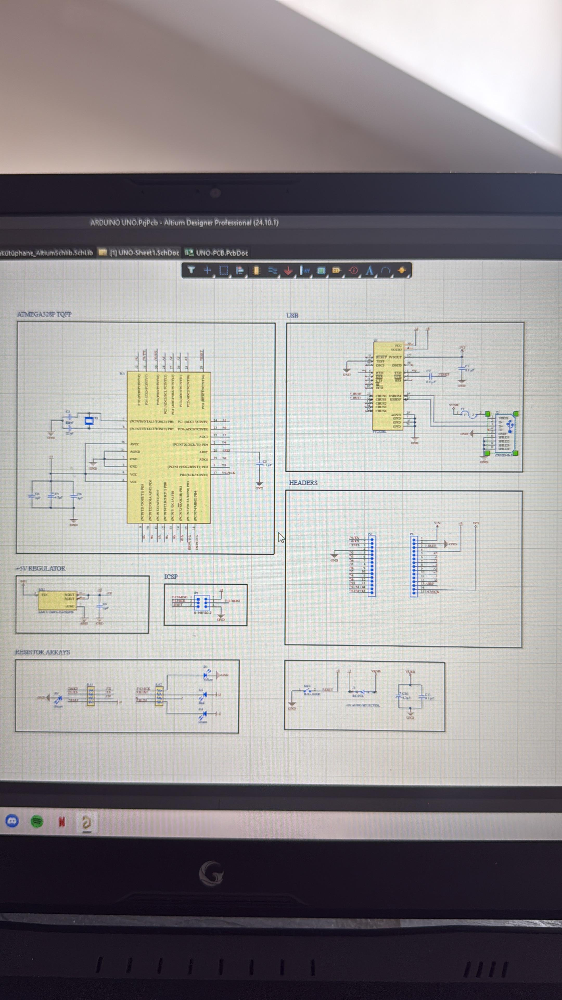
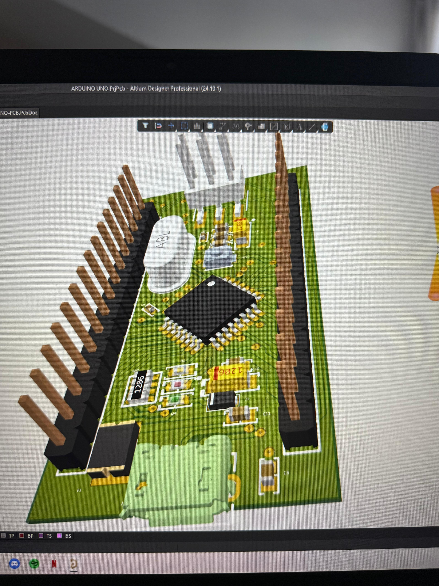
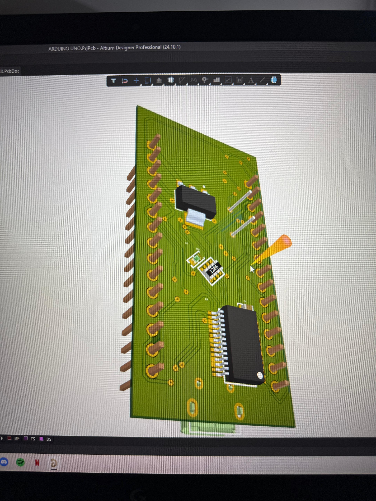

# Arduino Nano PCB Design

A PCB layout of the Arduino Nano development board, focused on compact component placement and board architecture.

## Features

- ATmega328P microcontroller
- Arduino Nano-compatible pinout
- SMD components
- USB-to-serial interface
- 5 V voltage regulation

## Design goals

- Understand the Arduino Nano's internal architecture.
- Practice compact PCB layout and component placement.
- Develop hands-on PCB-design skills with Altium Designer.

## Tools and references

- Altium Designer
- ATmega328P datasheet
- Arduino Nano reference schematic

## Design visuals

