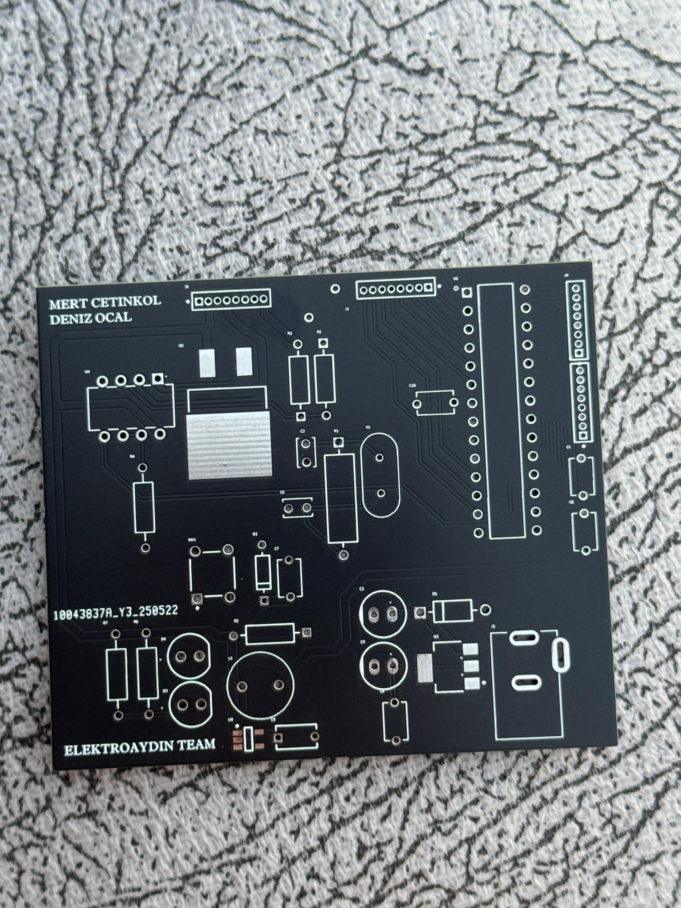
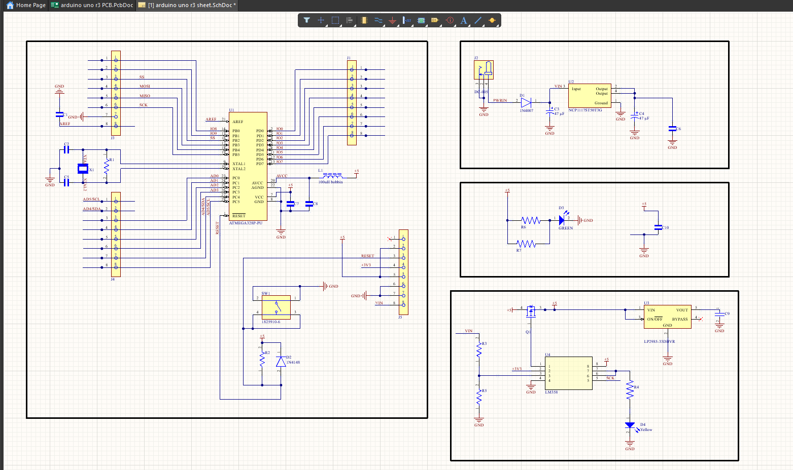

# Arduino Uno THT Version

A through-hole version of the Arduino Uno board, designed for easier manual assembly and prototyping.

> **Programming note:** This board is intended as a hardware replica. The ATmega328P must be pre-programmed using an external Arduino board or bootloader; code cannot be uploaded directly to this board.

## Features

- ATmega328P microcontroller (pre-programmed)
- Arduino Uno-compatible pinout
- Through-hole components for easier soldering
- USB-to-serial interface
- 5 V voltage regulation

## Design goals

- Learn microcontroller-board architecture.
- Practice PCB routing and component placement.
- Understand power and ground layout.
- Develop hands-on assembly skills.
- Provide an Arduino-compatible board without onboard programming capability.

## Tools and references

- Altium Designer
- ATmega328P datasheet
- Arduino Uno reference schematic

## Design visuals

