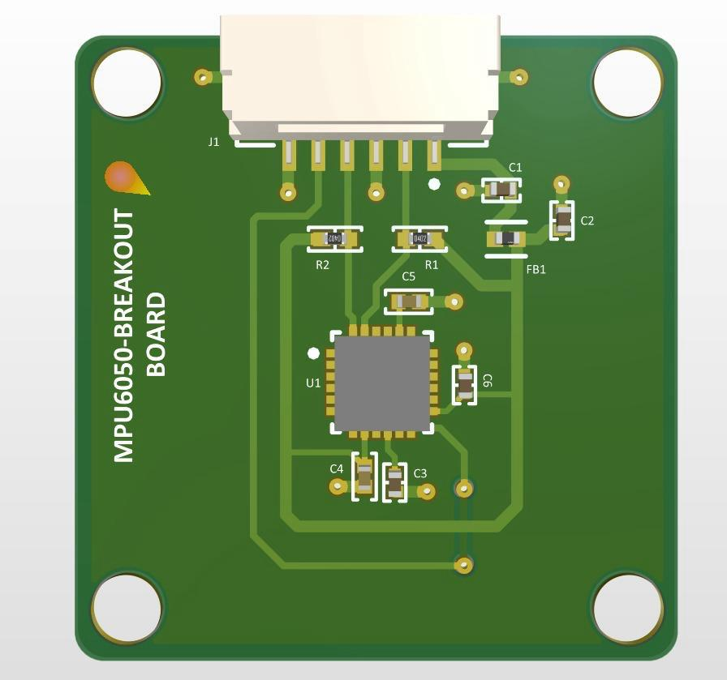
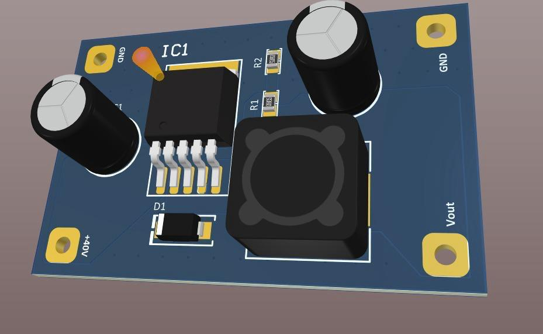
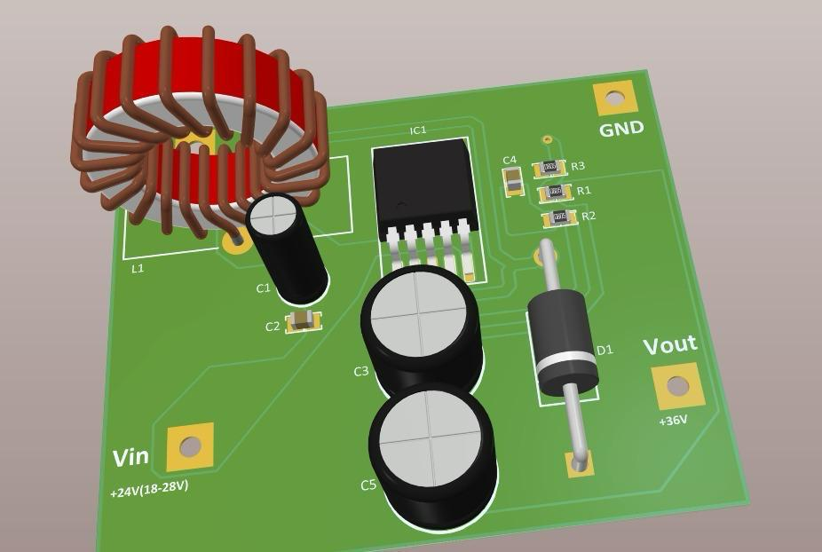
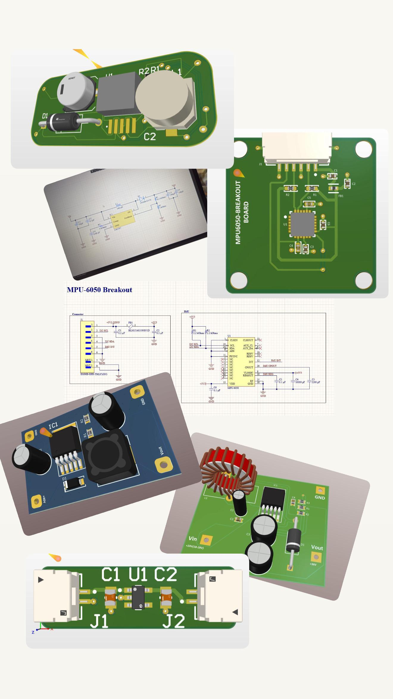
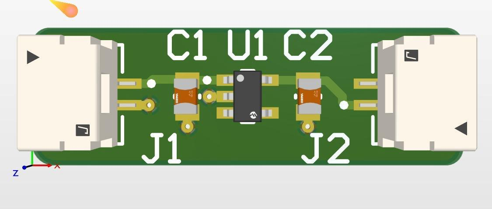

# Basic PCB Circuit Designs

Small PCB projects created to practice fundamental design principles in Altium Designer.

## Focus areas

- Component placement
- Signal routing
- Power and ground layout
- PCB design rules
- Practical board-design skills

## Tools

- Altium Designer
- PCB Toolkit V8.40

## Project visuals

