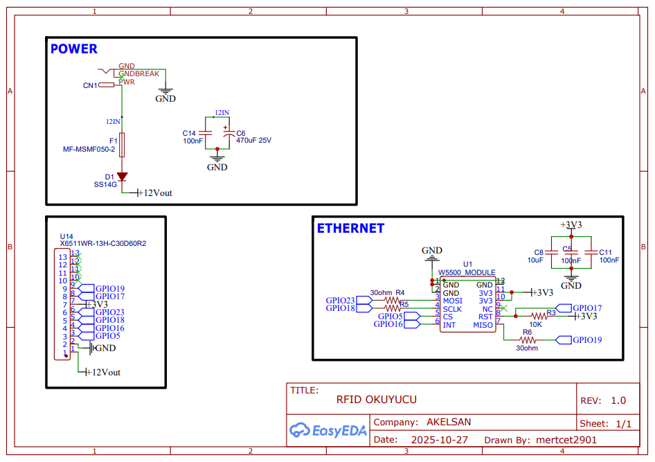
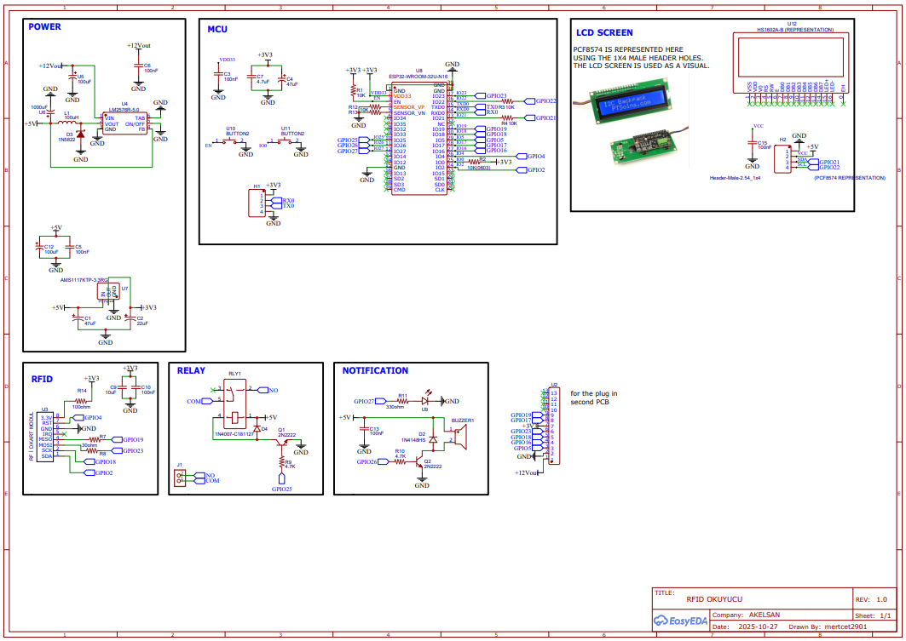
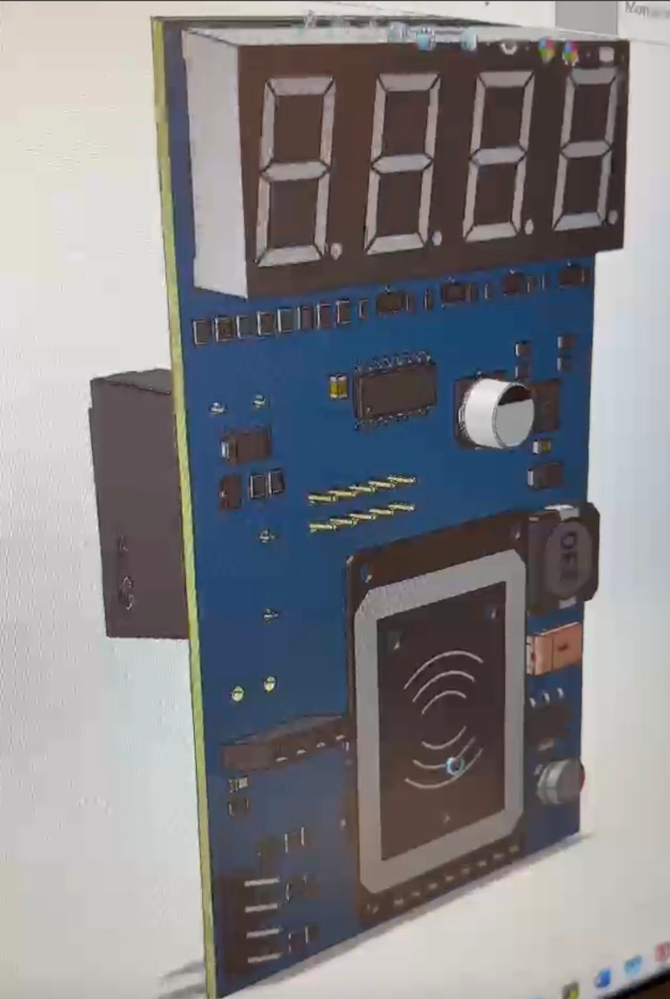

# ESP32-Based RFID Control System

> Designed and developed by me during my internship as a hardware-design task requested by **Akelsan Teknik Güvenlik Sistemleri ve Yönetim Danışmanlığı Tic. Ltd. Şti.**

The design brings RFID card reading, user notification, relay control and LCD status display together in an ESP32-based system. It covers power management, microcontroller interfacing, RFID communication, display integration, relay-driver circuitry and audio/visual notifications.

## System at a glance

- A 12 V input is converted to 5 V by an LM2576 regulator, then to 3.3 V by an AMS1117 regulator.
- The ESP32 interfaces with an MFRC522 RFID reader over SPI and a 16×2 LCD with a PCF8574 over I²C.
- A 2N2222 transistor drives the relay; a buzzer and status LED provide user feedback.
- The relay output can switch an external load.

## Hardware

| Function | Component | Role |
|---|---|---|
| Controller | ESP32-WROOM-32U-N16 | Main system controller |
| RFID reader | MFRC522 | RFID communication over SPI |
| Display | 16×2 LCD and PCF8574 | I²C user interface |
| Relay | 5 V relay | External-load switching |
| Relay driver | 2N2222 | Transistor relay driver |
| Notifications | Active buzzer and status LED | Audio and visual feedback |
| Power | LM2576-5.0 and AMS1117-3.3 | 12 V to 5 V, then 3.3 V |
| Protection | 1N4007 and 1N4148 | Relay and buzzer protection, respectively |

## ESP32 pin connections

| ESP32 pin | Connected device | Function |
|---|---|---|
| GPIO23 | MFRC522 MOSI | SPI data |
| GPIO19 | MFRC522 MISO | SPI data |
| GPIO18 | MFRC522 SCK | SPI clock |
| GPIO5 | MFRC522 SDA (SS) | Chip select |
| GPIO17 | MFRC522 RST | RFID reset |
| GPIO21 | LCD SDA | I²C data |
| GPIO22 | LCD SCL | I²C clock |
| GPIO25 | 2N2222 relay driver | Relay control |
| GPIO26 | Buzzer driver | Audio notification |
| GPIO27 | Status LED | Visual notification |

## Design scope

- Create multiple voltage rails from a 12 V input.
- Connect ESP32 peripherals and RFID communication lines.
- Design an I²C-based LCD interface.
- Design a transistor-based relay driver with a protection diode.
- Provide buzzer and LED feedback for events such as card reads, access decisions, insufficient balance and system status.
- Organize the schematic into functional blocks.

## Applications

The system architecture is suitable for access-control, card-based entry, smart-lock, RFID authorization and embedded-automation applications.

## Project visuals

### Schematics

### Board visuals

## Possible future improvements

- Complete the PCB design and prepare it for manufacturing.
- Design an enclosure.
- Add an authorized/unauthorized-card database and system logging.
- Add Wi-Fi or Bluetooth remote management.
- Integrate door locks or magnetic locks.
- Add a real-time clock.
- Develop a mobile or web application.

## Summary

The project combines power electronics, microcontroller interfacing, communication interfaces, user notifications and relay control in a modular embedded-system design.
